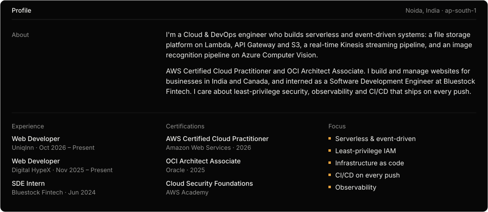
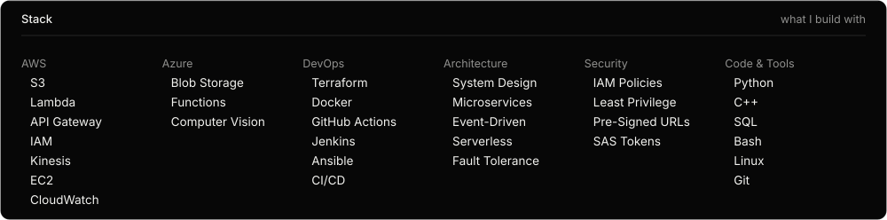

<!-- Panels in assets/ are generated: edit DATA in scripts/build_assets.py, then run `python scripts/build_assets.py`.
     stats.svg, top-langs.svg and the snake are rebuilt daily by .github/workflows/snake.yml into the `output` branch. -->

 

<picture>
  <source media="(prefers-color-scheme: dark)" srcset="https://raw.githubusercontent.com/vinitsoni03/vinitsoni03/output/snake-amber.svg" />
  <source media="(prefers-color-scheme: light)" srcset="https://raw.githubusercontent.com/vinitsoni03/vinitsoni03/output/github-contribution-grid-snake.svg" />
  
</picture>

